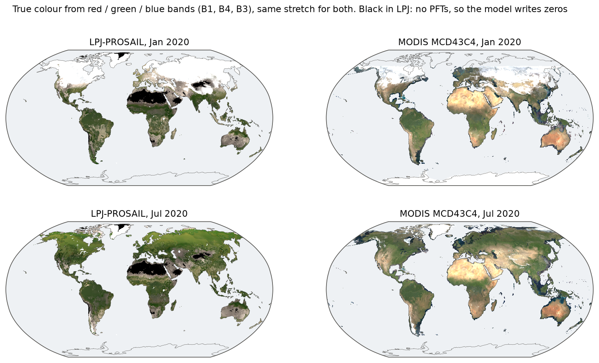
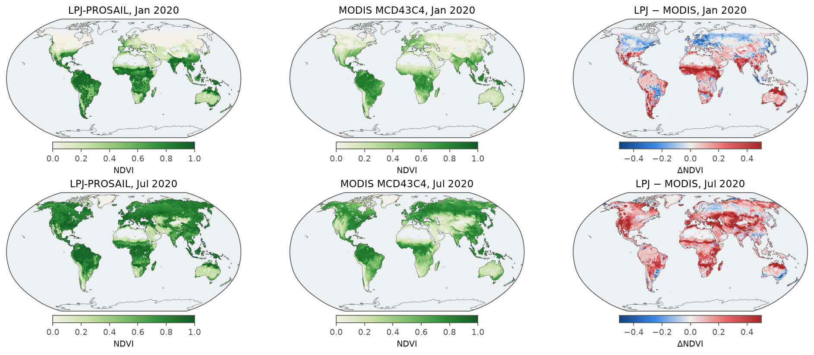
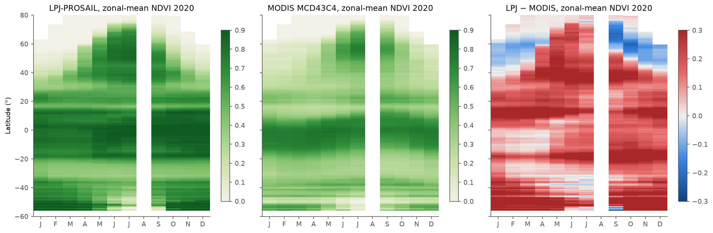
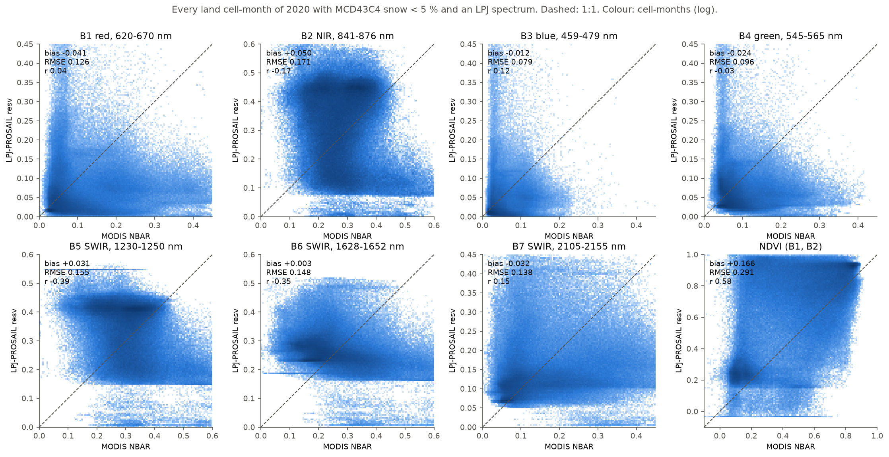
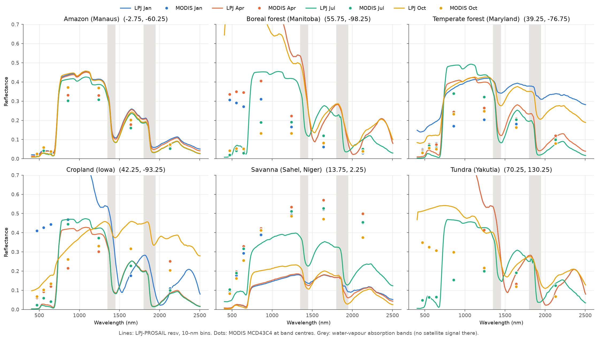
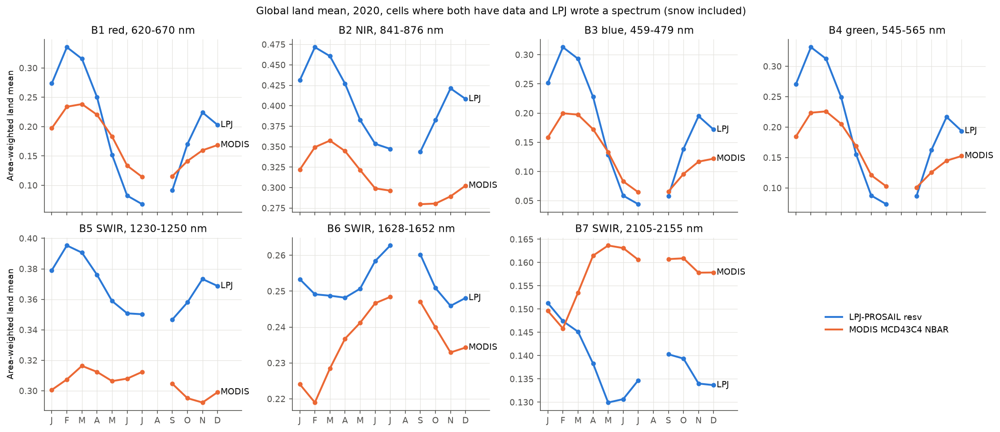
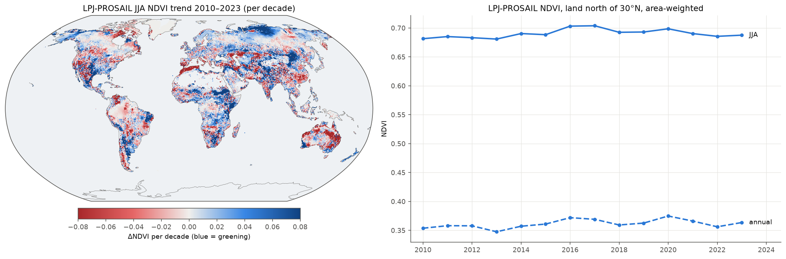

# LPJ-PROSAIL on Bryce's code (98892d37): global run vs MODIS

A global LPJ-PROSAIL run (1901–2023) on Bryce Currey's last LPJ commit, with monthly hyperspectral
reflectance (400–2500 nm, 10-nm bins) written for 2010–2023. Below it is compared against MODIS
MCD43C4 surface reflectance for 2020.

**Main results:**

- **NDVI patterns are right but too green.** Snow-free cell-months correlate at r = 0.58 (July alone: 0.72).
  LPJ NDVI is +0.17 too high on average (0.65 vs 0.48).
- **Dense canopies:** visible reflectance matches MODIS within 0.006. NIR is +0.12 too bright and SWIR is
  +0.04 to +0.10 too bright. Cell-to-cell correlation is near zero in every band.
- **Deserts are black.** 3,867 cells have no PFTs and write all-zero spectra (6 % of land cell-months).
  Bare ground never enters a cell's spectrum, so sparse vegetation looks like closed canopy over dark soil.
- **Snow is brighter and more widespread than MODIS** in northern winter.

## Run

| | |
|---|---|
| LPJ code | Bryce's fork, commit `98892d37` (2023-10-17), includes his clamp of the LMA/CBC absorption coefficients below ~420 nm |
| Patch on top | reflectance written every year ≥ 2010 instead of only the last year; HYPERSLAB monthly CRU reader (same inputs, faster) |
| Chain | spinup 1000 yr (NAT_VEG, CO2MEAN) → land use 398 yr (CONST_LU 1860) → transient 1901–2023 (TRANSIENT_LU) |
| Flags | `PROSAIL_PRO GROSS_LUC LUH_V2 MONTHLY CRU CO2TRENDY2 MONTHLYLITTER USDA SITCHCO2` |
| Drivers | CRU TS 4.10 (Bryce: 4.07), LUH 1700–2026 (Bryce: 850–2016), TRENDY v15 CO2 |
| Geometry | nadir view, sun position at 10:30 local solar time, updated each month |
| Jobs | 200 splits; transient array took 44 min to 6 h 14 min per split |
| Output | 62,482 cells written (of 67,420 in `grid.bin`), 23 GB, `/mnt/beegfs/scratch/tc229954e/prosail/bryce_commit/transient_2023/` |

Run script: `/mnt/beegfs/scratch/tc229954e/prosail/bryce_commit/run_prosail_bryce_commit.sh`.
The output binaries are int16 ×10000 with layout `(year, month, cell, 211 bins)`, cells in the order of `grid_<i>.out`.

## Comparison data and method

- **MODIS MCD43C4 v061**: nadir BRDF-adjusted reflectance (NBAR), 7 bands, 0.05°. Days 1, 9, 17 and 25 of each
  month of 2020, each averaged to 0.5° (at least 25 of 100 pixels valid), then averaged per month.
  **August is missing** (download failed).
- **LPJ to MODIS bands**: the `resv` spectrum (directional reflectance to the sensor) averaged over each MODIS
  band's edges, e.g. B1 = 620–670 nm.
- **Geometry difference**: NBAR is nadir view at the local-solar-noon sun angle; LPJ is nadir at 10:30.
- **Masks**: band statistics leave out cell-months where MCD43C4 reports ≥ 5 % snow, and cells where LPJ wrote zeros.

## True colour

Same red/green/blue stretch for both. Things that stand out:

- **Black deserts in LPJ** (Sahara, Arabia, Gobi, Taklamakan, central Australia): no PFTs, so PROSAIL is never called and the
  cell writes 0 at every wavelength.
- **LPJ is darker** wherever vegetation is sparse (Sahel, Australia, the western US). MODIS sees bright soil there.
- **January snow**: LPJ covers western and central Europe and northern China, where MODIS is mostly snow-free, and LPJ snow is brighter.

## NDVI

- **Too green across most of the land**, worst in drylands and the northern summer (30–60°N, April–September).
- **Too low at 40–65°N in winter**: LPJ has more snow there than MODIS.
- **Southern high latitudes** (Patagonia, 40–55°S): LPJ NDVI stays high all year.

## Band by band

All snow-free cell-months with an LPJ spectrum (n = 416,422):

| Band | MODIS mean | LPJ mean | Bias | RMSE | r |
|---|---:|---:|---:|---:|---:|
| B1 red 620–670 nm | 0.108 | 0.068 | −0.041 | 0.126 | 0.04 |
| B2 NIR 841–876 nm | 0.276 | 0.326 | +0.050 | 0.172 | −0.17 |
| B3 blue 459–479 nm | 0.052 | 0.039 | −0.012 | 0.079 | 0.12 |
| B4 green 545–565 nm | 0.090 | 0.067 | −0.024 | 0.096 | −0.03 |
| B5 SWIR 1230–1250 nm | 0.309 | 0.340 | +0.031 | 0.155 | −0.39 |
| B6 SWIR 1628–1652 nm | 0.260 | 0.264 | +0.003 | 0.148 | −0.35 |
| B7 SWIR 2105–2155 nm | 0.176 | 0.144 | −0.032 | 0.138 | 0.15 |
| **NDVI** | 0.481 | 0.647 | **+0.166** | 0.291 | **0.58** |

Densely vegetated cell-months only (MODIS NDVI > 0.5, n = 212,656):

| Band | MODIS mean | LPJ mean | Bias | r |
|---|---:|---:|---:|---:|
| B1 red | 0.050 | 0.056 | +0.006 | 0.02 |
| B2 NIR | 0.282 | 0.405 | **+0.123** | 0.04 |
| B3 blue | 0.028 | 0.027 | −0.001 | 0.03 |
| B4 green | 0.058 | 0.060 | +0.002 | −0.15 |
| B5 SWIR | 0.292 | 0.395 | **+0.104** | −0.08 |
| B6 SWIR | 0.192 | 0.276 | +0.084 | −0.03 |
| B7 SWIR | 0.092 | 0.127 | +0.036 | 0.15 |

Over dense canopy the visible means are right, but NIR and SWIR are too bright. In every band the
cell-to-cell correlation is close to zero: LPJ gets the average canopy, not the spatial variation.
Across all land, the negative correlations come from drylands. There MODIS sees bright soil, while LPJ shows
dark soil under a canopy with high NIR.

Full table: [band_stats.csv](img/bryce_98892d37/band_stats.csv).

## Spectra at six sites

- **Amazon**: spectral shape right; NIR plateau +0.07 to +0.14 above MODIS.
- **Sahel**: LPJ visible ≈ 0.02 against MODIS 0.2–0.3, because the bare-soil fraction is ignored.
- **Boreal forest, Iowa, Yakutia**: LPJ snow (April, January, April) reaches 0.7+ in the visible, against 0.3–0.45 in MODIS where it has data.
- **Maryland, January**: LPJ shows a mixed snow/vegetation spectrum; MODIS is snow-free.

## Global seasonal cycle

The LPJ land-mean seasonal cycle has a larger amplitude than MODIS in the visible and NIR. It is brighter in
January–March (snow) and darker in June–July: red falls to 0.07, against 0.13 for MODIS.

## LPJ NDVI 2010–2023

LPJ only (no MODIS trend was computed). JJA NDVI north of 30°N stays between 0.68 and 0.70, with a small rise
from 2010 to 2016.

## Why deserts and drylands come out dark

In `src/energy/output_reflectance.c` the cell spectrum is a sum over PFTs weighted by
`pft->fpc / totfpc × stand->frac / totstandfrac_natural`. The PFT weights always add up to 1, so the bare
fraction `1 − totfpc` never contributes. Soil enters only as the PROSAIL background under each PFT's own LAI.
A cell with no PFTs adds nothing and writes zeros.

A possible fix (not tested): add a bare-soil term, `(1 − totfpc) × rsoil`, where `rsoil` is the same wet/dry soil mix
PROSAIL already uses.

## Code

Analysis scripts: [lpj_grid.py](img/bryce_98892d37/code/lpj_grid.py) (grids the 200 splits, convolves to MODIS
bands), [mcd43_month.py](img/bryce_98892d37/code/mcd43_month.py) (MCD43C4 download and 0.5° averaging),
[plots.py](img/bryce_98892d37/code/plots.py). On Hellgate: `/mnt/beegfs/scratch/tc229954e/prosail/bryce_commit/analysis/`.
