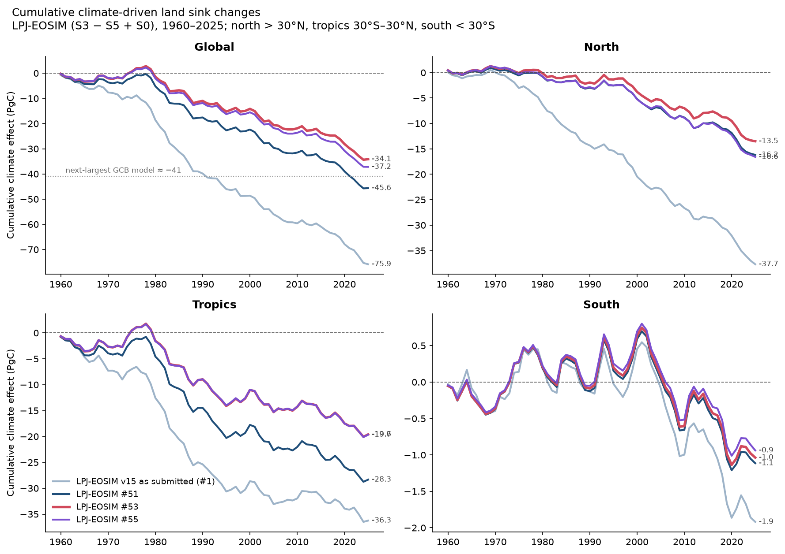
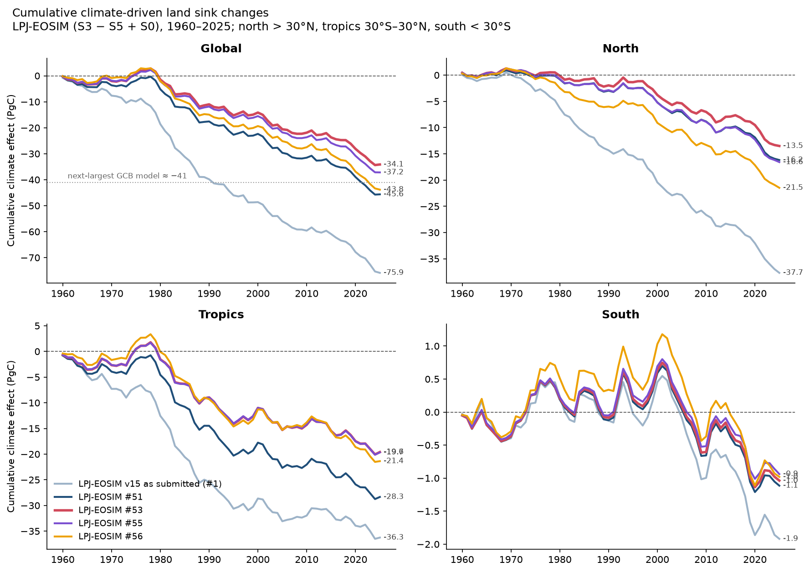
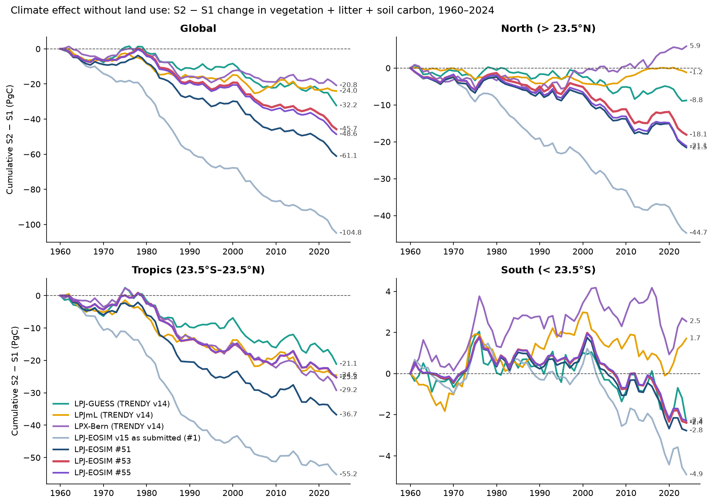
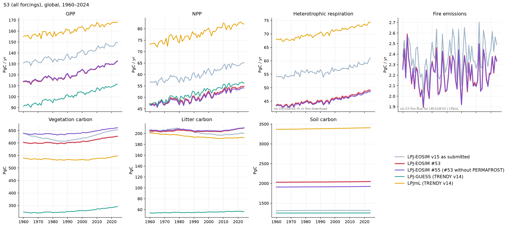
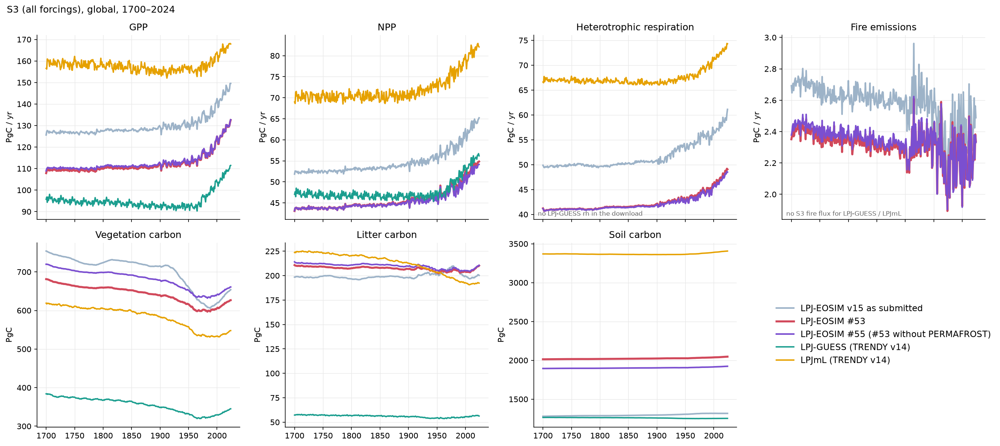
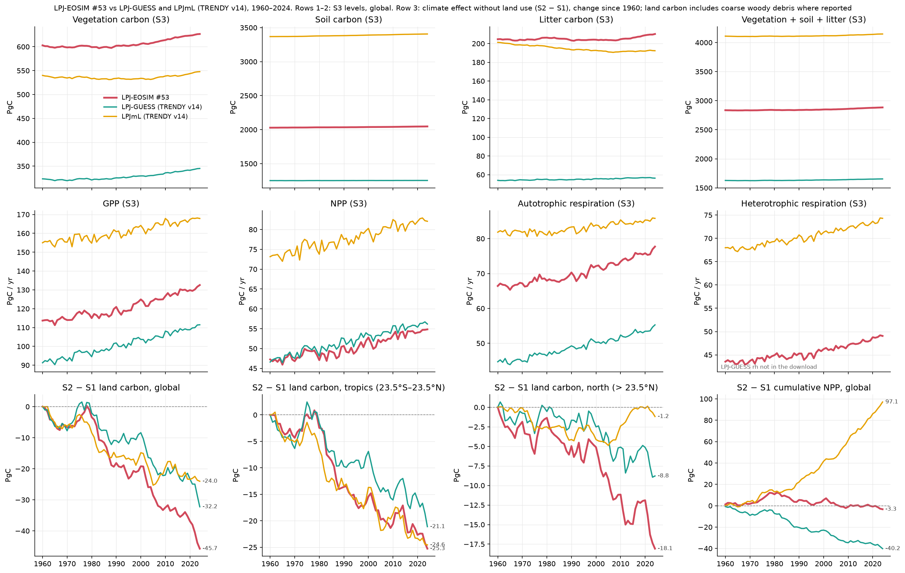
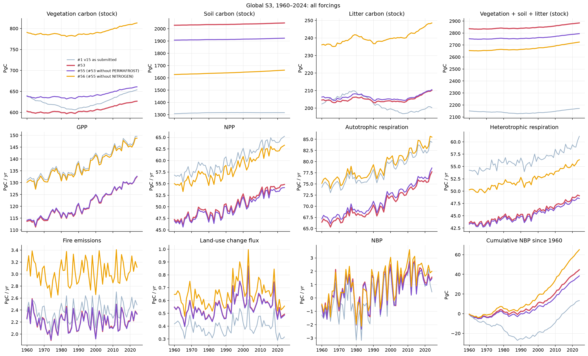
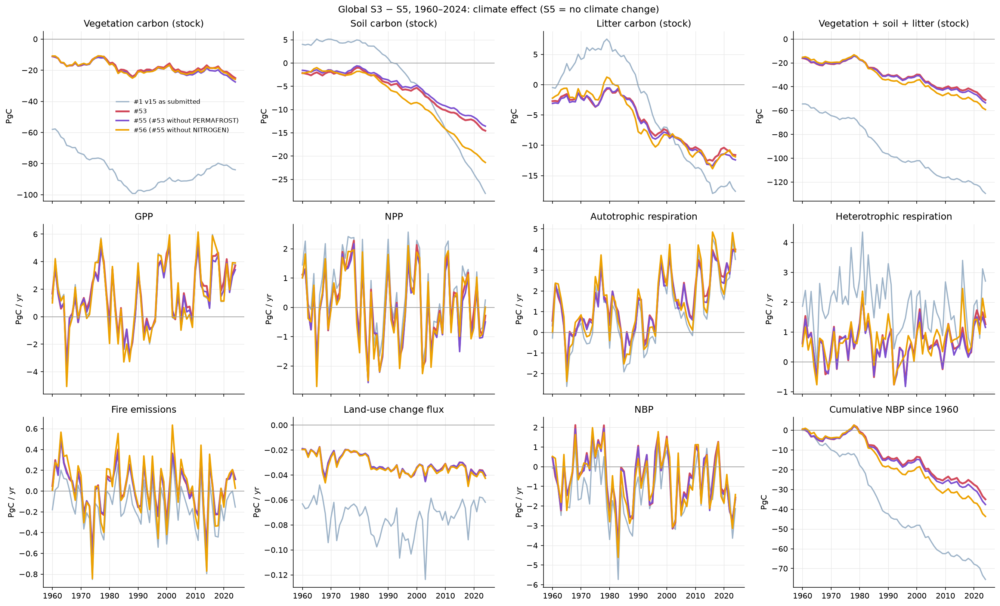
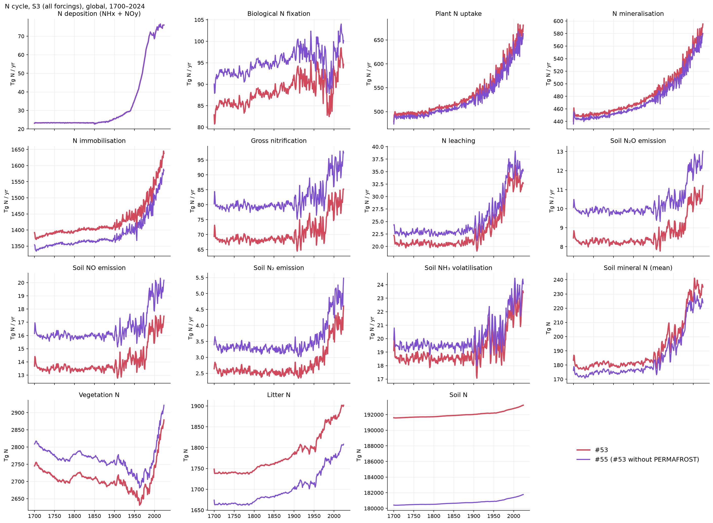

# Climate-effect fixes: runs #53 and #55

LPJ-EOSIM's TRENDY v15 climate effect (S3 − S5 + S0, 1960–2025) was −76 PgC, the GCB outlier; the
next-largest model is about −41. Runs #53 and #55 bring it to **−34 and −37 PgC** with changes taken from
LPJmL or fixing bugs, and put the S3 land sink on the TRENDY median.

[**ILAMB site →**](../results/ilamb-climate-effect-53-55/index.html) ·
[**ILAMB dashboard, absolute scores →**](../results/ilamb-climate-effect-53-55/dashboard.html)

Code: LPJ branch `exp-fix-ncap` (b5d555b), 16 commits on `trendy-v15`. Every change is a compile flag;
the default build is unchanged. Climate: CRU TS 4.10, as submitted.

## What changed

| Flag | What it does | Source |
|---|---|---|
| `TREES_OVER_GRASS` | When tree + grass cover > 1, grass shrinks instead of trees being thinned into litter | LPJmL ≥ 4.0 |
| `LARCH_SLA=0.02118` | Larch specific leaf area set to LPJmL's value (ours, from the longevity formula, is 0.041) | LPJmL parameter |
| `PERMAFROST` | Soil respiration uses the heat-diffusion + snow soil temperature; soil ice physics on | existing option (**off in #55**) |
| `LPJML_ESTAB_GATE` | Tree establishment stops at 0.95 cover. Ours used `&&`, which never fires; LPJmL uses `\|\|` | bug fix, matches LPJmL |
| `FPC_MIXVEG` | Tree cover recomputed when stand fractions change (dry cells kept stale FPC) | bug fix |
| `RESPONSE_CAP` | Decomposition capped at its 10 °C, field-capacity rate (`littersom.c`, and ported to CENTURY under N) | LPJmL since 4.0.001 |
| `NITROGEN` | N cycle on, NMIP3 N deposition (NaN at 7 ice-margin cells set to 0), no fertilizer | existing option |
| `K_MORT=0.2` | Growth-efficiency mortality coefficient 0.5 → 0.2 | LPJmL since 4.0.001 |

**#55 = #53 without `PERMAFROST`.**

## Climate effect

S3 − S5 + S0, cumulative 1960–2025, PgC (GCB bands: north > 30°N, tropics 30°S–30°N, south < 30°S):

| Band | v15 as submitted (#1) | #51 | **#53** | **#55** | GCB figure, v15 |
|---|---:|---:|---:|---:|---:|
| Global | −75.9 | −45.6 | **−34.1** | **−37.2** | ≈ −76 |
| North | −37.7 | −16.2 | −13.5 | −16.6 | ≈ −37.5 |
| Tropics | −36.3 | −28.3 | −19.6 | −19.7 | ≈ −36.5 |
| South | −1.9 | −1.1 | −1.0 | −0.9 | ≈ −1.9 |

#1 reproduces the GCB figure's LPJ-EOSIM numbers, which checks the method. #51 is #53 with k_mort 0.5.

| | #1 | #53 | #55 | TRENDY v14 median |
|---|---:|---:|---:|---:|
| S3 cumulative NBP 1960–2024 (PgC) | 13.3 | **44.7** | 38.4 | 44.5 |
| S2 − S1 cumulative NBP 1960–2024 (PgC) | −105.2 | −45.0 | −47.9 | |

### Without nitrogen: run #56

#56 is #55 without NITROGEN (no PERMAFROST either; S0, S3, S5 only).

| S3 − S5 + S0, 1960–2025 (PgC) | #55 (N on) | **#56 (N off)** |
|---|---:|---:|
| Global | −37.2 | **−43.8** |
| North (> 30°N) | −16.6 | −21.5 |
| Tropics | −19.7 | −21.4 |
| S3 cumulative NBP 1960–2024 (TRENDY v14 median 44.5) | 38.4 | 65.1 |

Without N the climate effect is 6.6 PgC worse, mostly in the north (soil + litter), and the S3 sink is
too large. k_mort 0.2 gains little without N: about 2 PgC over #49 (cap, PERMAFROST, k_mort 0.5).
The N-mode carbon budget gap (~1 PgC) is 0 in #56, so it does come from the N code.

This is not a pure N on/off test: the decomposition cap acts on a different scheme in each. Without N,
decomposition runs in `littersom.c` with LPJmL's cap (response ≤ 1 on the Lloyd & Taylor scale); with N,
it runs in CENTURY with the ported cap (≤ `temperature_modifier(10)` ≈ 0.19).

### How each change contributed

Each step adds one change; S3 − S5 1960–2024 global, no S0 term (so ≈ 1 PgC off the GCB metric):

| Run | Adds | S3 − S5 (PgC) |
|---|---|---:|
| #37 base | v15 physics | −75.6 |
| #3 | trees over grass | −65.1 |
| #38 | larch SLA | −60.6 |
| #39 | PERMAFROST | −52.1 |
| #47 | establishment gate | −55.6 |
| #48 | FPC refresh | −55.5 |
| #49 | decomposition cap | −46.0 |
| #51 | NITROGEN (cap ported to CENTURY) | −46.5 |
| **#53** | **k_mort 0.2** | **−35.0** |
| **#55** | #53 without PERMAFROST | −37.6 |

PERMAFROST was worth 8.5 PgC on the #38 → #39 stack but only 2.6 on the final one: the cap, N and k_mort
now do most of that work.

### Against the LPJ family (S2 − S1)

The other models are only on Hellgate for S1/S2 (TRENDY v14; v15 is not accessible), so this compares the
climate effect without land use, as the change in vegetation + litter + soil carbon (23.5° bands).

The tropics are now inside the family; the north is still about 10–20 PgC more negative.

## Why: where the climate loss came from

`code/churn/mort51.py`, `mort53.py`: S2 − S1 vegetation budget terms by band and PFT, 1960–2023.

**Tropics.** Climate costs #51 the same NPP as the LPJ family (−32 PgC; family −29 to −45), but #51 lost
−31 PgC of vegetation against −7 to −13 for the family: its losses did not fall with NPP. Growth-efficiency
mortality rose +30 PgC (tropical evergreen and raingreen trees), offset by −32 PgC less cover-cap thinning.
`mortality_tree.c` is the same formula as LPJmL's; the only difference was k_mort (0.5 vs LPJmL's 0.2).
With 0.2 (#53) the tropical vegetation loss falls to −18 PgC.

**North.** Warming adds +28 PgC of NPP, but almost none of it is kept as vegetation: two-thirds goes through
C3 grass, which turns over each year or is cut back under the tree canopy by `light()`, and boreal evergreen
needleleaf loses to light competition (−2.7 PgC) while summergreen trees gain. LPJ-GUESS keeps half its NPP
gain as vegetation; LPJmL gains four times the NPP. A shared C3/C4 grass canopy (as in LPJmL, run #54)
changed nothing: the two grasses almost never share a cell.

## Global stocks and fluxes (S3)

v15 as submitted, #53, #55, LPJ-GUESS and LPJmL (TRENDY v14):

#53 against LPJ-GUESS and LPJmL: S3 levels, then S2 − S1 by band:

## Climate effect over time (S3 − S5)

v15 as submitted, #49, #51 and #53. Upper rows: S3; lower figure: S3 − S5 for every stock and flux.

k_mort 0.2 halves the S3 − S5 vegetation loss; litter loses ~3 PgC more (more dead wood). GPP, NPP and Ra
are unchanged from #51: k_mort changes residence time, not productivity.

## Nitrogen cycle

N inputs: NMIP3 NOy + NHx deposition (1850–2024, held at 1850 before), biological N fixation computed in
the model, no fertilizer or manure. Two values look high against published estimates: soil N 182–192 Pg N
(whole column; ~133–140 Pg N in the top metre, Batjes 1996) and soil N₂O 8–13 Tg N yr⁻¹ (natural soils
~5.6, Global N₂O Budget; ours also includes soils under land use).

## ILAMB

[**ILAMB site →**](../results/ilamb-climate-effect-53-55/index.html) ·
[**dashboard, absolute scores →**](../results/ilamb-climate-effect-53-55/dashboard.html)

Same `ilamb.cfg` as the 7a1fa06 benchmark page. Global region. LPJ-GUESS and LPJmL are TRENDY v14 S3
(CRU-JRA climate); LPJ-GUESS has no Reco score (no rh in TRENDY).

| Model | Biomass | GPP | Reco | Soil C | ET | Burned area | Runoff |
|---|---:|---:|---:|---:|---:|---:|---:|
| **#53** | 0.639 | **0.645** | **0.605** | 0.656 | **0.691** | 0.517 | 0.688 |
| **#55** | 0.609 | 0.643 | 0.602 | 0.675 | 0.690 | 0.516 | 0.689 |
| v15 as submitted | 0.645 | 0.621 | 0.573 | 0.693 | 0.690 | **0.524** | 0.690 |
| LPJ-GUESS v14 | 0.695 | 0.632 | — | **0.732** | 0.676 | 0.499 | 0.701 |
| LPJmL v14 | **0.707** | 0.580 | 0.567 | 0.333 | 0.658 | 0.500 | **0.709** |

#53 is better than v15 as submitted on GPP and Reco, level elsewhere, and worse on soil carbon
(0.656 vs 0.693): it holds ~2,000 PgC of soil carbon against ~1,300.

## Caveats

- **Carbon budget.** With NITROGEN, stock change minus cumulative NBP over 1901–2020 is ~1 PgC in S0/S1/S2
  (0 without N). Same in every N run (#50–#55), so it comes with the N code, not these changes; not traced.
- **Other models are TRENDY v14** (CRU-JRA climate); TRENDY v15 files are not accessible to us.
- **Numbers without S0′** (marked in the run table) differ from the GCB metric by ~1 PgC.
- **Not included:** WSOLVE_FAST (ported and tested bit-identical separately, on `exp-fix-ncap-wsolve`),
  the CRU TS 4.05 cloud test (#37, #40), Ångström 0.30/0.345 (#43, #52; our own fit, set aside).
